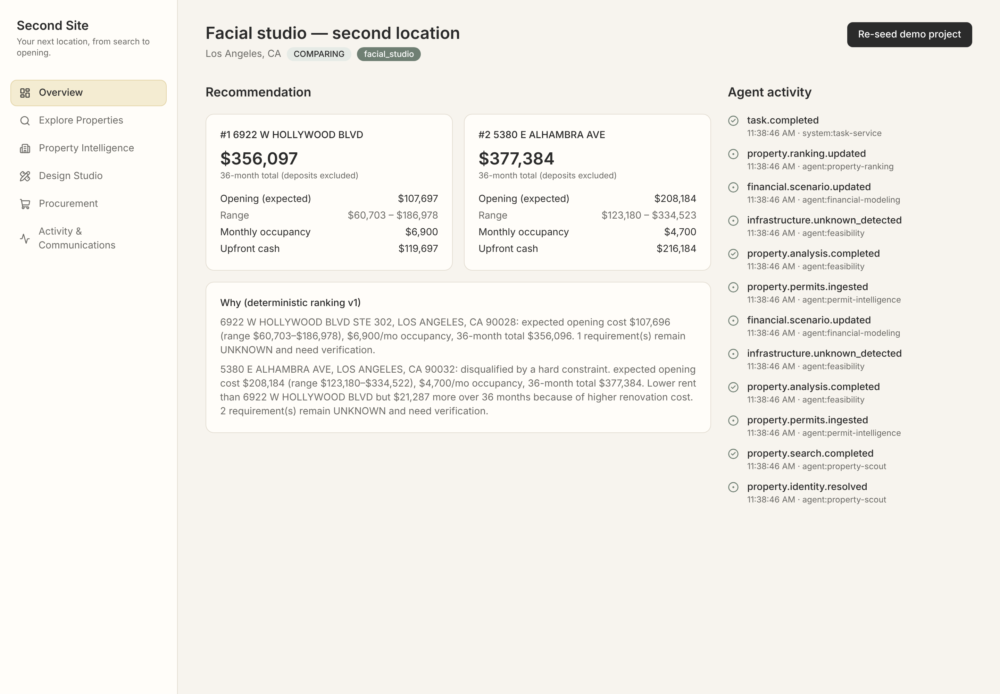
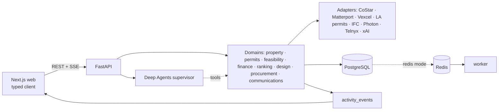

# Second Site

**Your next location, from search to opening.** HackPrinceton Fall 2026 · Main track: Business and Enterprise.

Second Site helps a business owner open location #2: find commercial properties, check whether the building can
actually host the business (using public permit history plus interior/exterior data), compare **total** cost rather
than rent, contact brokers through an approval-gated assistant, generate geometry-validated layouts, and turn the
chosen layout into a room-by-room bill of materials. Every step writes to the same project records.

> Status: the end-to-end slice runs on **real sponsor data** — CoStar data-kit lease listings, Matterport measured
> suite scans, Vexcel aerial imagery — plus live LA permit records. Photon, Telnyx and xAI are adapters awaiting
> credentials — see [Provider status](docs/PROVIDER_STATUS.md). Nothing here claims a live integration it doesn't have.



## Architecture


Details: [ARCHITECTURE](docs/ARCHITECTURE.md) · [DATA_FLOW](docs/DATA_FLOW.md) · [AGENT_ARCHITECTURE](docs/AGENT_ARCHITECTURE.md) · [CONTRACTS](docs/CONTRACTS.md) · [EVENTS](docs/EVENTS.md) · [API](docs/API_SPECIFICATION.md)

## Stack
Python 3.12 · FastAPI · Pydantic v2 · SQLAlchemy 2 · Alembic · PostgreSQL 16 · Redis · LangChain Deep Agents / LangGraph ·
Shapely · OR-Tools CP-SAT · Next.js 16 · React 19 · TypeScript · Tailwind v4 · react-konva · openapi-typescript · Docker Compose.

## Requirements
`uv`, Node ≥ 20.9 + `pnpm` (`corepack enable`), Docker (or local PostgreSQL 16 + Redis), `gh` (for the agent board).

## Quickstart
```bash
scripts/bootstrap.sh
```
```bash
scripts/dev.sh
```
Open http://localhost:3000 and click **Seed demo project**. API docs: http://localhost:8000/docs.
Without Docker: [runbooks/local-without-docker.md](docs/runbooks/local-without-docker.md). Full stack in containers: `make up`.

## Environment
Copy `.env.example` → `.env`. For real sponsor data: extract the CoStar kit to `.data/costar-kit`, add the
Matterport/Vexcel keys, and set `PROPERTY_PROVIDER_MODE`, `MATTERPORT_PROVIDER_MODE`, `VEXCEL_PROVIDER_MODE` to `live`.
Otherwise every provider defaults to **fixture** mode; real calls, messages and purchases are off
(`ALLOW_LIVE_OUTBOUND_CALLS=false`, `ALLOW_LIVE_PURCHASES=false`). `PERMIT_PROVIDER_MODE=live` uses the public LA API with no key.
`SUPERVISOR_MODEL` empty → deterministic supervisor; set e.g. `anthropic:claude-sonnet-5-5` + `ANTHROPIC_API_KEY` for the LLM.

## Commands
| Task | Command |
|---|---|
| All checks | `scripts/test.sh` |
| Backend tests | `cd apps/api && uv run pytest -q` |
| Regenerate contracts (Pydantic → OpenAPI → TS) | `scripts/generate-contracts.sh` |
| Contract drift check | `scripts/check-contracts.sh` |
| Migrations | `make migrate` |
| Smoke test (running API) | `scripts/smoke-test.sh` |
| Web typecheck / lint / build | `pnpm web:typecheck` · `pnpm web:lint` · `pnpm web:build` |

## Project structure
```
apps/api/        FastAPI app: contracts/ (source of truth), domains/, integrations/, agents/, workflows/, services/, db/, alembic/, tests/
apps/web/        Next.js app (six destinations)
packages/contracts/  GENERATED OpenAPI, JSON Schemas, TypeScript types
fixtures/        real LADBS permit snapshot + clearly labeled synthetic fixtures
scripts/  infra/  docs/  tools/board  .claude/
```

## Team branches and responsibilities
| Branch | Workstream | Start here |
|---|---|---|
| `dev/agents-finance` | Deep Agents supervisor, requirements, feasibility, finance, ranking, evidence | [onboarding](docs/onboarding/agents-finance.md) |
| `dev/property-spatial` | CoStar/Matterport/Vexcel, LA permits, identity, IFC, geometry solver | [onboarding](docs/onboarding/property-spatial.md) |
| `dev/frontend-product` | Web app, design studio, interior, procurement, approvals UI | [onboarding](docs/onboarding/frontend-product.md) |
| `dev/communications` | Photon, Telnyx, xAI voice, handoff, webhooks | [onboarding](docs/onboarding/communications.md) |

All four start at the same foundation commit. Workflow: [TEAM_WORKFLOW](docs/TEAM_WORKFLOW.md) · [MERGE_STRATEGY](docs/MERGE_STRATEGY.md) · [OWNERSHIP_MATRIX](docs/OWNERSHIP_MATRIX.md).

## Agent message board
Teammates' coding agents coordinate on pinned issue #1 via `tools/board` (`whoami`, `unread`, `read -n 20`, `post`, `wait`).
Rules live in [AGENTS.md](AGENTS.md); the original template docs are in [docs/AGENT_BOARD.md](docs/AGENT_BOARD.md).

## Provider status (summary)
| CoStar | Matterport | Vexcel | LA permits | IFC-Bench | Deep Agents | Photon | Telnyx | xAI voice | Oracle | Sourcing |
|---|---|---|---|---|---|---|---|---|---|---|
| LIVE (data kit) | LIVE | LIVE | LIVE-capable | PARTIAL | PARTIAL | PARTIAL (code complete) | PARTIAL (code complete) | NOT_STARTED | NOT_STARTED | MOCK |

## Security and truthfulness
Secrets only in `.env` (gitignored). Approvals bind the exact payload hash and are enforced at the action boundary.
Webhooks are signature-verified on the raw body and deduplicated. Historical permits are shown as historical with
limitations; unknown infrastructure stays UNKNOWN; synthetic listings say so; layouts carry a "not a code review" disclaimer.
The calling assistant is presented as the owner's assistant, discloses automation where required, and never impersonates a human.

## Hackathon tracks
CoStar "Inside and Out" · LangChain Deep Agents · Photon 2.0 (incl. Best Voice Agent) · Peri Forward Deployed ([evidence form](docs/PERI_CONSULTATION.md)) · Amazon Practical AI.
Deadline **8:00 am ET, Sunday Nov 15, 2026**; demo ≤ 2 minutes; repository must be public.

## Demo
Live sponsor mode: Seed demo → 10 real CoStar LA lease spaces ranked on total cost (rent + quoted or flagged-estimate
operating costs + build-out); Property Intelligence shows CoStar terms, the Matterport tour of the listed suite and
Vexcel aerial + roof observations; Design Studio lays the program out inside the measured walls of 630 W 6th St #110B.

Fixture mode:
1. Seed demo project → ranking shows Hollywood #302 beating the lower-rent Alhambra building over 36 months, with reasons.
2. Property Intelligence → real LADBS permits (800A service, 2" water service, suite-302 sink) with scope, match status and "historical ≠ current" limitations.
3. Design Studio → generate two validated layouts → Procurement → room-linked BOM.
4. Property Intelligence → "Ask the broker" → Activity: approve → Start call → (no Telnyx keys) "Run simulated broker
   call": disclosure, grounded questions, deposit question escalates to you (Photon text / Join card), findings
   become broker-reported evidence and re-rank the shortlist. Link Photon by texting the agent (or "Send as me").
Data notes: [DEMO_DATA](docs/DEMO_DATA.md).

## Known limitations
Messaging and voice are not connected yet; few listed suites have a Matterport scan named for the suite; layouts use
the largest rectangular area of a measured floor; LA permit datasets start in 2020; dev auth only.
