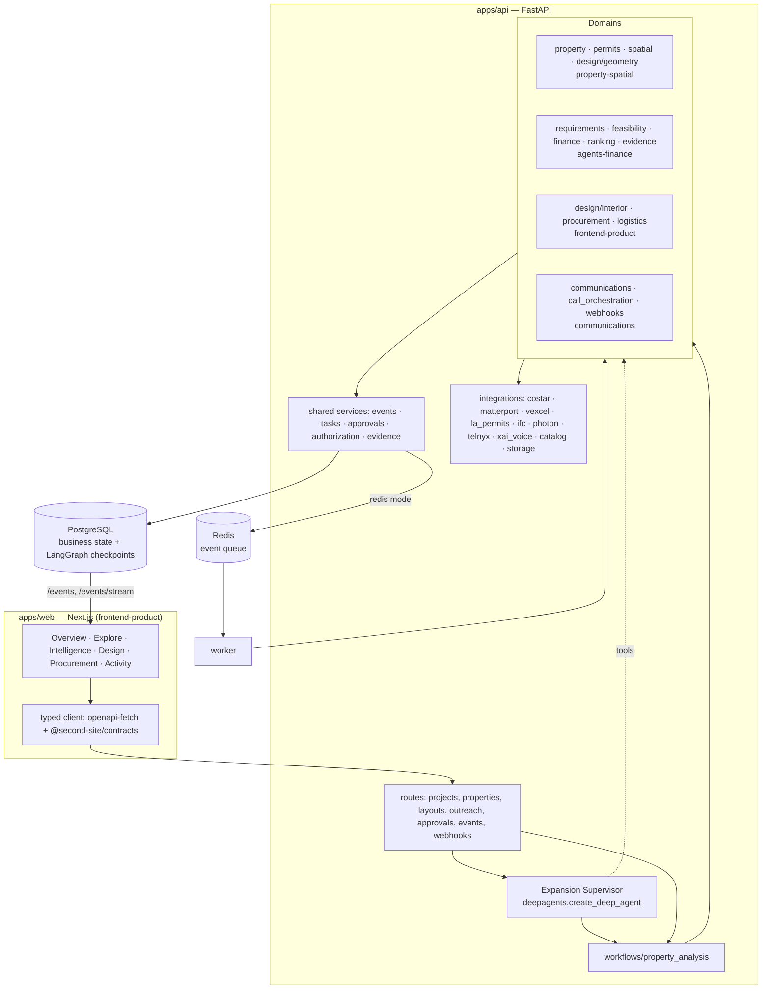

# Architecture

Three kinds of state, kept apart:
1. **Business state** — Postgres tables (`projects`, `properties`, `permit_records`, `property_observations`, …). Authoritative.
2. **Agent execution state** — LangGraph checkpoints (InMemorySaver / PostgresSaver). Never read as facts.
3. **Conversation state** — chat/Photon/call transcripts referenced from `communications`. Never authoritative.

Every component's owner, contract and consumer: see `SUBSYSTEM_OWNERSHIP.md` and `CONTRACTS.md`.
