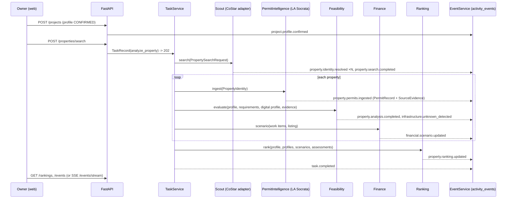

# Data flow

## Event-driven recomputation (tested)
`infrastructure.evidence_updated` → feasibility re-evaluates that property (old rows `superseded`) →
`property.analysis.completed` → `financial.scenario.updated` → ranking subscriber →
`property.ranking.updated` (new version). Each hop carries `causation_id` of the previous event.

## Layout revision path (tested)
`DesignRevisionRequest` (e.g. 4 treatment rooms) → CP-SAT solver → Shapely validation →
new `DesignVersion` with `parent_version_id` → `layout.version_created` → BOM on request.
Infeasible → `layout.validation_failed`, revision `INFEASIBLE`, last valid version untouched.
Next steps (owners): construction implications → `bom.recalculation_required` → updated `CostScenario`.
